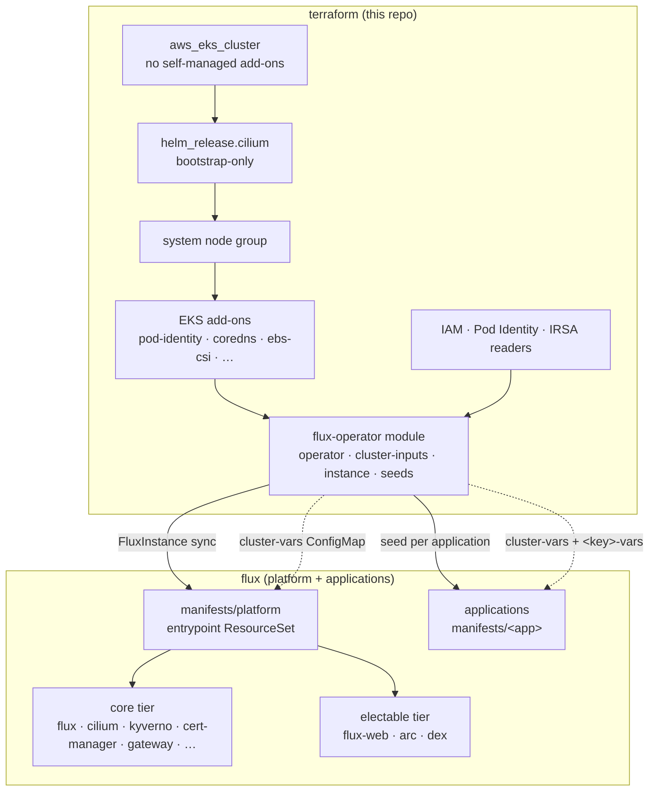

# Architecture

The cluster module draws a hard line between what Terraform owns and what flux owns. **Terraform owns AWS**: the
cluster, IAM, queues, tags, addresses and the bootstrap. **Flux owns Kubernetes**: every chart and every custom resource
after the first apply. The one place the two meet is a single ConfigMap of cluster facts, `cluster-vars`.

## The layers

## Design decisions

### Cilium in ENI mode, never the AWS VPC CNI

`bootstrap_self_managed_addons = false` means EKS never installs `vpc-cni`, `kube-proxy` or `coredns` itself. Cilium is
the CNI and replaces kube-proxy, and pods hold routable VPC addresses just as they would under `vpc-cni`. Raw
`CiliumNetworkPolicy` and `FQDNNetworkPolicy` work as a result, which managed Cilium distributions usually reject.
Cilium is also the Gateway API implementation. See [Networking](networking.md).

### Karpenter for workload capacity

Terraform owns Karpenter's IAM roles, its interruption queue, the discovery tags and the _shape_ of the default
NodePool. The platform's karpenter component owns the chart and renders the `EC2NodeClass`/`NodePool` from that shape. A
small always-on **system node group** (`role=system`) carries the platform controllers. See [Capacity](capacity.md).

### One entrypoint, two tiers

The `FluxInstance` syncs one small image, `oci://<registry>/manifests/platform`. Its `ResourceSet` ranges over
`PLATFORM_COMPONENTS` and emits an `OCIRepository` and a `Kustomization` per component.

- The **core tier** always deploys: flux, cilium, kyverno, kyverno-policies, cert-manager, cert-manager-issuers,
  external-dns, gateway, aws-load-balancer-controller, rbac and secret-sync.
- The **electable tier** is opt-in through `platform_components`: `flux-web` and `arc`. `dex` deploys when `sso.enabled`
  is true.

Every component is its own image, so you can pin one with a `<NAME>_MANIFESTS_REF` cluster var, soak it or roll it back
on its own. See [The flux contract](contract.md).

### Applications are their own images

`applications` seeds each one with a bootstrap-only `ResourceSetInputProvider` + `ResourceSet`. The image ships the same
two objects and takes them over on its first reconcile. Releasing an application never needs a `terraform apply`, and
removing its key uninstalls it. See [Applications](applications.md).

### Terraform deploys no chart that flux doesn't go on to manage

Everything AWS offers as a managed add-on is taken as one (`addons`). Everything else is a platform component or an
application. The only helm releases Terraform installs are bootstrap hand-overs. Each is applied once, then ignored
(`ignore_changes`) and adopted by flux:

| Release                          | Why Terraform installs it                           | Adopted by                      |
| -------------------------------- | --------------------------------------------------- | ------------------------------- |
| `cilium`                         | A node can't report `Ready` without a CNI.          | the platform's cilium component |
| `flux-operator`, `flux-instance` | Something has to install flux.                      | the platform's flux component   |
| `application-<key>`              | Something has to point flux at each application.    | the application's own image     |
| `cluster-inputs`                 | The contract itself. It stays Terraform-reconciled. | (not adopted)                   |

### One ECR prefix, create-on-push

ECR has no arbitrary-path model. A repository creation template with `CREATE_ON_PUSH` makes up for that: publishers push
to `<prefix>/charts/<name>`, `<prefix>/images/<path>` or `<prefix>/manifests/<name>`, and ECR creates the repository.
Push rights are scoped per publisher. ECR replication copies every push to a replica in each region clusters run in, and
each cluster reads the replica beside it, so a primary-region outage never stops it reconciling. Reads are granted
org-wide, so onboarding a cluster account never edits the store. See [Registry & signing](supply-chain.md).

### Cosign everywhere

Every chart, image and manifest image is cosign-signed. **Keyless** is the default: GitHub Actions OIDC identities,
verified by certificate subject. **KMS** is the alternative. Flux verifies the platform entrypoint, every component and
every application, and Kyverno verifies images at admission. See
[Registry & signing](supply-chain.md#signing-and-verification).

### EKS Pod Identity for every workload with a pod

Platform and application workloads get IAM through Pod Identity associations. The exception is the secret-sync reader
service accounts. Those syncs run without a pod, so they use IRSA. See [Identity & secrets](identity.md).

### DNS and TLS survive cluster recreation

The delegated Route53 zone lives upstream, and the Gateway's Elastic IPs are reserved outside the cluster's lifecycle.
You can destroy and recreate a cluster, and it serves the same addresses with no manual steps. See
[Networking](networking.md#gateway-addresses).

## Where each concern lives

| File                    | Concern                                                                                 |
| ----------------------- | --------------------------------------------------------------------------------------- |
| `main.tf`               | Node and cluster IAM, the cluster, access entries, node groups, add-ons, SG restriction |
| `cilium.tf`             | Cilium's helm values, ENI permissions, the bootstrap release                            |
| `karpenter.tf`          | Discovery tags, node and controller roles, the interruption queue and rules             |
| `gateway.tf`            | The Gateway's Elastic IPs (reserved or referenced) and NLB subnets                      |
| `dns.tf`                | Looking up the delegated public (and optional private) zone                             |
| `iam.tf`                | Workload roles: platform grants, `workload_grants`, IRSA secret readers                 |
| `sso.tf`                | platform dex clients, generated client secrets, `flux-web` auth config, secret policies |
| `flux.tf`               | The `cluster-vars` contract and the `flux-operator` module call                         |
| `modules/flux-operator` | The bootstrap helm releases and the flux controllers' registry roles                    |
| `modules/application`   | One application published from its own root; owns the shared application seed chart     |
| `modules/node-group`    | One managed node group behind a launch template                                         |
