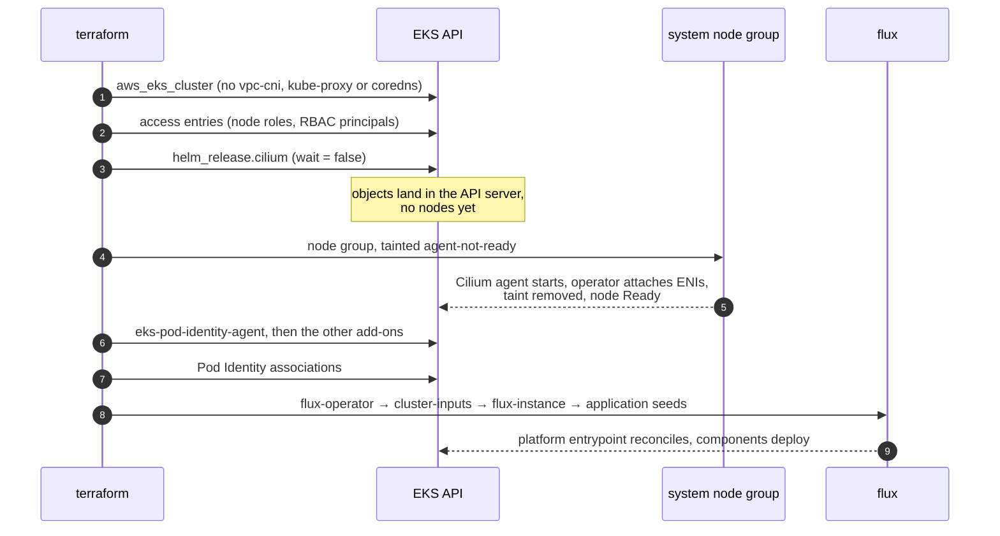

# Bootstrap order

One `terraform apply` against an empty account has to produce a reconciling cluster. That only works if resources are
created in a strict order, and every `depends_on` in the module exists to hold that order.

The root of the problem: a node can't report `Ready` without a CNI. In ENI mode the Cilium agent can't report ready
until the Cilium operator has attached ENIs to the node.

## The sequence

1. **The cluster, with no self-managed add-ons.** No `vpc-cni`, no `kube-proxy`, no `coredns`.
2. **Access entries** for the node roles (`EC2_LINUX`, plus `EC2_WINDOWS` if a Windows group exists) and the RBAC
   principals. Nodes can't register until their role is admitted.
3. **Cilium** as a `helm_release` with `wait = false`. There are no nodes yet, which is the point: the objects land in
   the API server, and agents start as soon as a node registers. Waiting for readiness here would deadlock against step
   4, which depends on this release.
4. **The system node group**, tainted `node.cilium.io/agent-not-ready=true:NoExecute`. Cilium tolerates every taint, and
   its operator removes this one once the agent is ready. Because Cilium is already installed, nodes reach `Ready`
   promptly instead of failing with `NodeCreationFailure`.
5. **Add-ons.** `eks-pod-identity-agent` goes first, because every other IAM-bearing add-on and workload gets
   credentials through it. An add-on only reports `ACTIVE` once its pods are healthy, so all add-ons wait for the node
   group.
6. **Pod Identity associations**, then **the flux bootstrap chain**: `flux-operator`, `cluster-inputs` (the
   `cluster-vars` and `<key>-vars` ConfigMaps and the pre-created namespaces), `flux-instance`, then one
   `application-<key>` seed per application.

## Why Cilium's ENI permissions sit on the node role

In ENI mode the Cilium operator needs AWS credentials during step 4. The agent can't report ready until the operator has
attached ENIs. But the pod-identity-agent add-on only arrives in step 5, so giving the operator a Pod Identity
association would create a cycle.

So the ENI permissions go on the **node role** by default. The AWS VPC CNI does the same thing. Once a cluster is
running, you can set `cilium.operator_pod_identity = true` to move them onto a Pod Identity association.

Windows nodes never get the Cilium grant or the bootstrap taint. Cilium has no Windows datapath, so the taint would
never be removed and the group would never schedule a pod.

## Restricting the default security group

EKS always creates an `eks-cluster-sg-*` group with allow-all egress and attaches it to the control-plane ENIs and every
node. It can't be replaced or detached, only edited. With `network.restrict_default_security_group` on, the module:

1. adds the documented minimum self-referencing egress rules (API server 443, kubelet 10250, DNS 53 TCP/UDP), then
2. revokes the `0.0.0.0/0` and `::/0` egress rules through the AWS CLI.

Terraform can't delete rules on a group it doesn't manage, which is why this step uses the CLI. The step runs after the
add-ons are `ACTIVE`. Bootstrap therefore behaves the same with the toggle on or off, and open egress closes only once
the cluster is up. The revoke runs once per cluster and ignores drift: a rule you add back by hand stays.

## Steps that need a second apply

- **`sso.kubectl`.** EKS checks the OIDC issuer's discovery endpoint when it creates the identity provider config. dex
  only exists after flux reconciles it. Apply with `sso.kubectl.enabled = false` first, then turn it on once dex is
  serving.
- **Gateway API activation.** The platform's gateway component installs the Gateway API CRDs after Terraform's Cilium
  release. Cilium only turns on its Gateway API controller if the CRDs exist when the agent and operator start. The
  first Cilium rollout after the CRDs are established (an upgrade or a restart) activates it. This needs no Terraform
  action.
