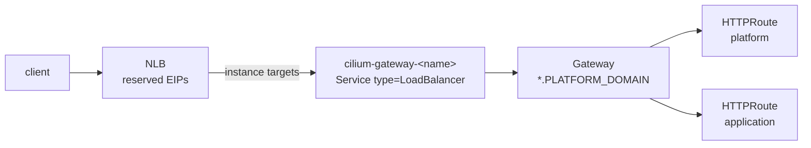

# Networking

## Cilium in ENI mode

Cilium is the cluster's CNI, its kube-proxy replacement and its Gateway API implementation. The AWS VPC CNI is never
installed. `addons` rejects `vpc-cni` and `kube-proxy`, because the VPC CNI would fight Cilium for ENI ownership.

The module uses ENI mode rather than an overlay because pods need routable VPC addresses. That lets the control plane
reach admission webhooks directly, and the datapath matches what `vpc-cni` would have given.

The Terraform-installed release sets what's specific to this cluster:

| Setting                | Value                                                                                                       |
| ---------------------- | ----------------------------------------------------------------------------------------------------------- |
| ENI datapath           | Pod ENIs come from `network.pod_subnet_ids`, defaulting to the node subnets. Unused addresses are released. |
| Masquerading           | Only traffic leaving the VPC is masqueraded, since pods already carry VPC addresses.                        |
| kube-proxy replacement | Needs a direct route to the API server (`k8sServiceHost`), so the release follows the cluster.              |
| Gateway API            | Enabled. One Gateway creates one `LoadBalancer` Service.                                                    |
| Placement              | One operator replica, on the host network, tolerating the not-ready taint.                                  |
| Node init              | `nodeinit` cleans up leftover CNI configuration on nodes that join or rejoin.                               |

`cilium.helm_values` is merged over the computed values for anything not modelled. The release is bootstrap-only. After
the first apply, the platform's cilium component adopts it by name and upgrades it from the registry. Two cluster vars,
`CILIUM_K8S_SERVICE_HOST` and `CILIUM_POD_SUBNET_IDS`, carry the cluster-specific values so the component reproduces
them exactly instead of removing them on adoption.

## The API endpoint

The private endpoint is always on, so nodes and in-VPC clients never use the public one. The public endpoint is opt-in
through `public_access`, for bootstrapping from CI or workstations without a VPN path. If you enable it without
`public_access.cidrs`, it's open to `0.0.0.0/0`.

Authentication is `API` mode: access entries are the only authorization surface, and the `aws-auth` ConfigMap is never
used. The creating principal is admitted automatically. `cluster_admin_principals` adds break-glass and CI identities
with `AmazonEKSClusterAdminPolicy`.

## The Gateway

The platform serves HTTP through one Cilium Gateway with a wildcard `https` listener on `*.<PLATFORM_DOMAIN>`, backed by
`Certificate platform-wildcard`. Platform and application routes attach to it by hostname. A route can attach from any
namespace labelled `platform.bitwisemedia.uk/gateway-access: "true"`.

Cilium creates one `LoadBalancer` Service per Gateway. The AWS Load Balancer Controller turns that Service into an NLB.
That's the controller's only job here: Cilium owns all L7 routing.

!!! info "Why the NLB targets instances, not IPs"

    The AWS Load Balancer Controller can only register IP targets when the AWS VPC CNI is the datapath. Under any other
    CNI it's limited to instance targets, whatever the pods' addresses look like. The module publishes
    `GATEWAY_NLB_TARGET_TYPE = instance` so the constraint is visible in the cluster vars.

### Gateway addresses

The Gateway's Elastic IPs live outside the cluster's lifecycle. After a cluster is destroyed and recreated, it serves
the same addresses, external-dns records barely change, and the domain comes back without manual steps. Adding a host is
a manifests-only change: an `HTTPRoute` and its DNS record.

There are two ways to supply the addresses:

- **Reserve them here** (`gateway.reserve_static_ip = true`, the default): one EIP per public subnet the NLB spans.
- **Reference existing allocations** (`reserve_static_ip = false` with `allocation_ids`), for example a reservation
  owned by another root.

The allocation ids reach the gateway component as `GATEWAY_EIP_ALLOCATIONS`, alongside `GATEWAY_SUBNETS`.

### A private Gateway

With `gateway.private = true` the NLB is `internal`, spans the node subnets, and has no Elastic IPs. It's only reachable
through private resolution, so it requires `dns.private_zone`, and stable addressing comes from the private zone's
records. The EIP vars are published empty, and `GATEWAY_NLB_SCHEME` becomes `internal`.

`network.internal_subnet_ids` moves the NLB onto other subnets, which `GATEWAY_SUBNETS` then names. Use it when the node
subnets aren't routable from where clients are, for example when nodes sit in a non-routable range and NAT out, and a
smaller set of routable subnets carries ingress. The NLB keeps `instance` targets, so the nodes stay where they are. The
module never tags these subnets with the discovery tag, so Karpenter never launches nodes into them.

### Gateway API CRDs

EKS ships no `gateway.networking.k8s.io` CRDs, and Cilium implements the API without owning them. With
`gateway.install_crds` on (the default), the platform's gateway component installs the standard-channel set Cilium
needs. If AWS ever starts installing the CRDs itself, turn it off. The manifests then orphan the CRDs instead of pruning
them, since deleting a CRD deletes every Gateway and HTTPRoute with it.

## DNS

The delegated Route53 zone (for example `platform.example.com`) is created upstream and delegated from its parent once.
It deliberately lives outside this module, so destroying a cluster never touches the zone or its delegation. The module
looks the zone up, derives the domain, and passes the ids to external-dns and cert-manager as cluster vars.

- **The public zone always exists** when `dns.zone_name` is set. cert-manager's DNS-01 challenges resolve over public
  DNS, so even a fully internal cluster keeps a public zone for certificates. Its id is `DNS_PUBLIC_ZONE_ID`.
- **The private zone** (`dns.private_zone`) adds split-horizon DNS: a private zone with the same name, associated with
  the cluster VPC, which shadows the public one inside the VPC. Its id is `DNS_PRIVATE_ZONE_ID`. external-dns runs one
  instance per zone and publishes the same records into each.

`PLATFORM_DOMAIN` is the zone apex unless `dns.host` narrows it to a sub-host. Every route hangs off it.
