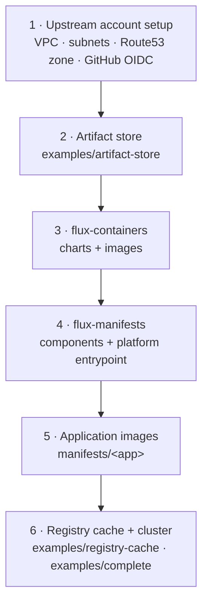

# Bootstrap a platform

A fresh platform comes up in six steps. Each step publishes or creates something the next one consumes. The order is
fixed: a cluster can't sync a platform that hasn't been published, and nothing can be published before the store exists.

## 1. Upstream account setup

Create these outside this repo: the account, the VPC, private node subnets and public subnets, and NAT or the
ECR/S3/STS/EKS VPC endpoints. Add the delegated Route53 zone and the GitHub Actions OIDC provider too. Tag the subnets
with `kubernetes.io/role/elb` (public) and `kubernetes.io/role/internal-elb` (private) so the Gateway's NLB can find
them.

## 2. The artifact store

Apply [`examples/artifact-store`](examples.md#artifact-store) in the platform account. Add one entry to
`github.manifest_publishers` for each repo that publishes manifests: the platform repo, and each application repo.

Then pass the example's outputs to the publishing repos as GitHub Actions variables:

| Actions variable              | Set on                        | From the example's output                 |
| ----------------------------- | ----------------------------- | ----------------------------------------- |
| `AWS_CHART_PUBLISHER_ROLE`    | flux-containers               | `publishers.chart`                        |
| `AWS_MANIFEST_PUBLISHER_ROLE` | each manifest-publishing repo | `publishers.manifests["<repo>"]`          |
| `AWS_PLATFORM_REGISTRY`       | every publishing repo         | `platform_registry.url` (host and prefix) |
| `AWS_REGION`                  | every publishing repo         | the store's region                        |

Keep `registry_id` too. Every cluster account's registry cache points at it.

!!! warning "Set each publisher's `repository_id`"

    GitHub mints immutable OIDC subjects that embed the numeric repo id for repos created after 2026-07-15. Until a
    publisher's `repository_id` is set, its trust falls back to the name-only subject, which those repos never
    present. Once the repo exists, set its id and apply again.

## 3. Publish charts and images

Run flux-containers' publish workflow. It mirrors every chart and image the platform needs into the store and signs each
one keylessly. That includes `cilium` and `karpenter`, plus the runner scale-set controller chart and runner image if
you elect `arc`. The cluster bootstrap pulls the Cilium and flux charts from the store, so this step must finish first.

## 4. Publish the platform

Cut a flux-manifests release. Its publish workflow pushes every component image, then the platform entrypoint
(`manifests/platform`), and moves the `staging` tag on each.

## 5. Publish application images

Each application repo publishes `oci://<registry>/manifests/<app>` the same way, under its own publisher role.

## 6. The registry cache and the cluster

In the cluster's account, apply [`examples/registry-cache`](examples.md#registry-cache) first. Then apply the cluster.
[`examples/complete`](examples.md#complete) shows the full shape, with an application composed in. That one apply
bootstraps Cilium, flux-operator, the platform and the application seeds.
[Bootstrap order](../concepts/bootstrap-order.md) describes what happens inside it.

Two things land in a second apply:

- **kubectl SSO.** EKS checks the OIDC issuer when the identity provider config is created. dex only exists once flux
  has reconciled it. So apply with `sso.kubectl.enabled = false` first. Flip it on once dex is serving over its Gateway
  route.
- **SSO connector credentials.** Apply [`sso-secrets`](../modules/sso-secrets.md) in a durable root with the same `sso`
  value. Then add each secret's value out of band with `aws secretsmanager put-secret-value`.

## Onboarding another cluster account

You don't need to touch the store. Its registry policy admits every pull-through cache in the organization. In the new
account, apply `examples/registry-cache`, then the cluster.
