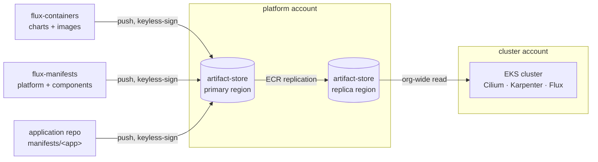

# Overview

terraform-aws-eks-flux is a set of Terraform modules that take an empty AWS account to a running, GitOps-managed EKS
cluster in one `terraform apply`. The root module creates the cluster and hands it to [flux-operator]. From then on the
cluster syncs a cosign-signed **platform** from ECR, plus any **applications** you seed. The module itself knows nothing
about any particular application.

## What you get

- **An EKS cluster with Cilium in ENI mode.** The AWS VPC CNI and kube-proxy are never installed. Cilium is the CNI, the
  kube-proxy replacement and the Gateway API implementation. Pods get routable VPC addresses.
- **Karpenter for workload capacity**, next to a small always-on _system_ node group for the platform controllers.
- **A flux bootstrap.** Terraform installs flux-operator and one `FluxInstance`, which syncs the platform entrypoint
  image. It also seeds each application image.
- **A supply chain to feed it.** A central ECR artifact store that publishers push to, replicated to every region
  clusters run in, and cosign verification everywhere (keyless by default, or KMS).
- **Generic inputs for applications.** An application's own Terraform module emits IAM grants, secret readers, dex
  clients and substitution vars. Your root passes those into the cluster module's generic inputs.

## The four repos in a deployment

A running platform spans four kinds of repository. This one supplies the infrastructure. The others publish what it
runs.

| Repo                                              | Role                                                                                 |
| ------------------------------------------------- | ------------------------------------------------------------------------------------ |
| **terraform-aws-eks-flux** (this one)             | The cluster, the artifact store and the flux bootstrap.                              |
| [flux-containers]                                 | Vendors, scans, mirrors and keyless-signs charts and images into the artifact store. |
| [flux-manifests] (the platform)                   | The platform entrypoint, plus one manifest image per component every cluster syncs.  |
| An application repo (e.g. [patchy-app-manifests]) | The application's manifest image and its out-of-cluster Terraform (secrets, IAM).    |

## The modules

| Module                                           | Where it's applied                         | What it does                                                        |
| ------------------------------------------------ | ------------------------------------------ | ------------------------------------------------------------------- |
| [cluster (root)](../modules/cluster.md)          | Each cluster account, in a disposable root | The EKS cluster, Cilium, Karpenter IAM, add-ons and flux bootstrap. |
| [artifact-store](../modules/artifact-store.md)   | The platform account, once                 | The central ECR prefix, its regional replicas and the publishers.   |
| [kms-signing-key](../modules/kms-signing-key.md) | A durable root (only in KMS signing mode)  | An asymmetric KMS key for cosign.                                   |
| [sso-secrets](../modules/sso-secrets.md)         | A durable root (only when SSO is enabled)  | The Secrets Manager containers for the dex connector's credentials. |
| [flux-operator](../modules/flux-operator.md)     | Internal, called by the root module        | The flux bootstrap chain of helm releases.                          |
| [node-group](../modules/node-group.md)           | Internal, called by the root module        | One managed node group behind a launch template.                    |

## Prerequisites

The module deliberately owns nothing that must outlive a cluster. Create these upstream, outside this repo:

- **An AWS account in an AWS Organization.** The store and the signing key grant reads by `aws:PrincipalOrgID`.
- **A VPC** with private node subnets and public subnets. It needs NAT, or VPC endpoints for ECR, S3, STS and EKS. The
  subnets need the `kubernetes.io/role/elb` / `kubernetes.io/role/internal-elb` tags. The cluster module adds the
  `karpenter.sh/discovery` tag itself.
- **A delegated Route53 hosted zone**, if the cluster serves a domain.
- **A GitHub Actions OIDC provider** in the platform account. The artifact-store module can create one if none exists.

On the machine that runs Terraform:

- Terraform `>= 1.11`, `< 2.0` (1.16.0 is excluded).
- **The AWS CLI.** The helm provider authenticates through an exec plugin that runs `aws eks get-token`. See
  [Caveats](../reference/caveats.md#the-helm-provider-needs-the-aws-cli).

## Next steps

- [Bootstrap a platform](bootstrap.md) walks through the end-to-end order, from the store to the first cluster.
- [Examples](examples.md) shows each runnable root configuration in `examples/`.
- [Architecture](../concepts/architecture.md) explains the design decisions behind it.

[flux-operator]: https://github.com/controlplaneio-fluxcd/flux-operator
[flux-containers]: https://github.com/bitwise-media-group/flux-containers
[flux-manifests]: https://github.com/bitwise-media-group/flux-manifests
[patchy-app-manifests]: https://github.com/bitwise-media-group/patchy-app-manifests
