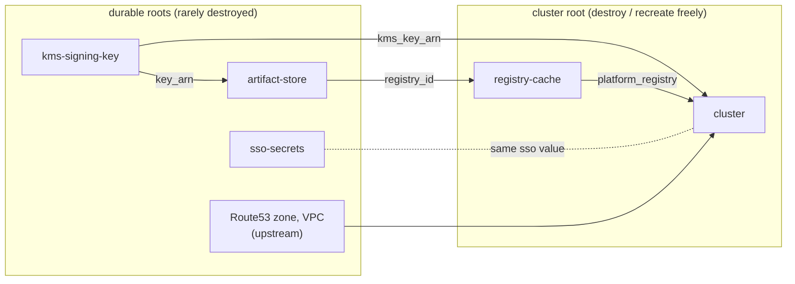

# Modules

The repo publishes one root module (the cluster) and seven submodules. Five of the submodules are building blocks you
call from your own roots. The other two are internal to the cluster module.

| Module                                | Call it from                   | Purpose                                                                            |
| ------------------------------------- | ------------------------------ | ---------------------------------------------------------------------------------- |
| [cluster (root)](cluster.md)          | a disposable cluster root      | EKS, Cilium, Karpenter IAM, add-ons, workload identity, SSO and the flux bootstrap |
| [artifact-store](artifact-store.md)   | the platform account, once     | The central ECR prefix and its GitHub Actions publishers                           |
| [registry-cache](registry-cache.md)   | each cluster account           | A pull-through cache of the store, beside the nodes                                |
| [kms-signing-key](kms-signing-key.md) | a durable root (KMS mode only) | The asymmetric key cosign signs with                                               |
| [sso-secrets](sso-secrets.md)         | a durable root (SSO only)      | Secrets Manager containers for the dex connector's credentials                     |
| [application](application.md)         | an application's own root      | One application published to an existing cluster, with its vars and identities     |
| [flux-operator](flux-operator.md)     | internal (the root module)     | The flux bootstrap helm releases and the controllers' registry roles               |
| [node-group](node-group.md)           | internal (the root module)     | One managed node group behind a launch template                                    |

## Sourcing

Pin every module to a release tag. Submodules use the `//modules/<name>` path:

```hcl
module "cluster" {
  source = "git::https://github.com/bitwise-media-group/terraform-aws-eks-flux.git?ref=vX.Y.Z"
  # ...
}

module "cache" {
  source = "git::https://github.com/bitwise-media-group/terraform-aws-eks-flux.git//modules/registry-cache?ref=vX.Y.Z"
  # ...
}
```

## Durable and disposable roots

Several modules exist so that some state can **outlive a cluster**. Split your roots by lifecycle:



- **The signing key** must outlive every store and cluster, since published artifacts verify against it forever.
- **The SSO connector credentials** are entered out of band. They must survive a cluster rebuild without being entered
  again.
- **The cluster root** can be destroyed and recreated. The zone, its delegation, the Gateway's addresses and the durable
  secrets all stay, so the cluster comes back on the same domain.

## Reference tables

Each module page ends with its inputs, outputs, resources and provider requirements. These are generated by
[terraform-docs] into the module's `README.md`, and the site embeds that block as is. `make lint` fails if a README's
block is stale, so the tables on this site always match the code they were built from.

[terraform-docs]: https://terraform-docs.io/
